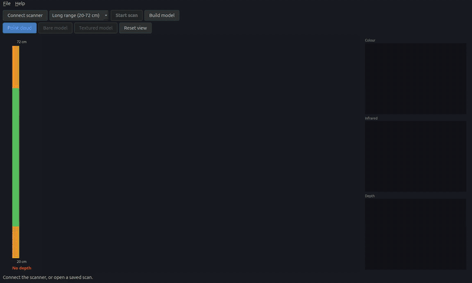
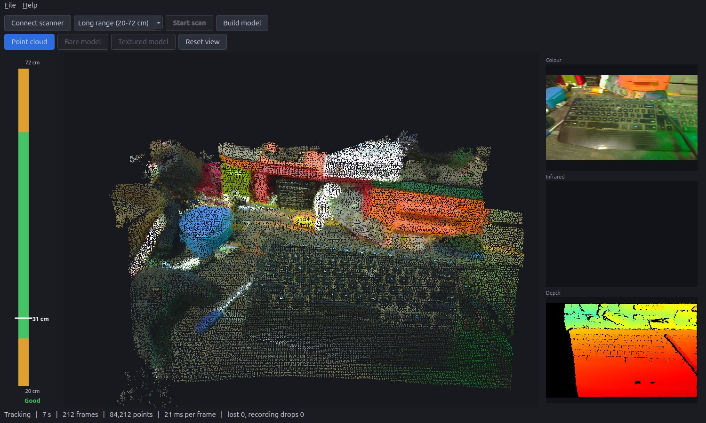
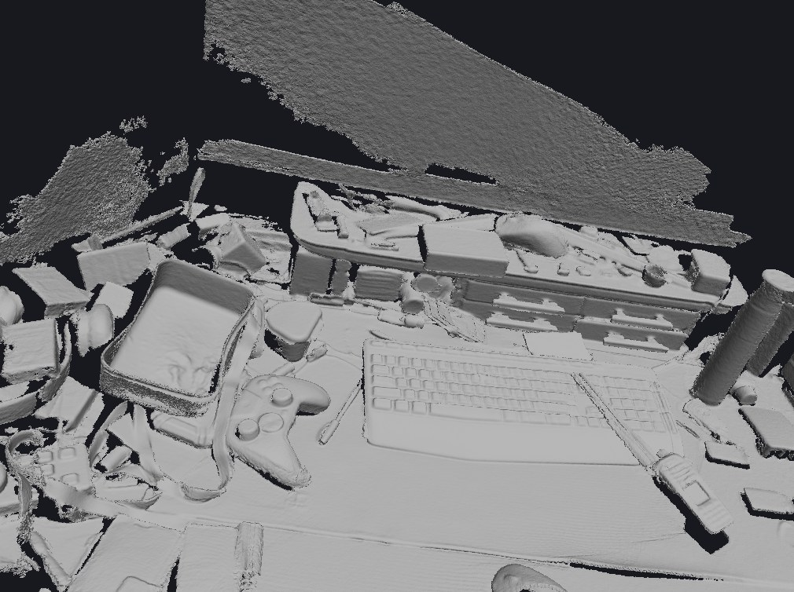
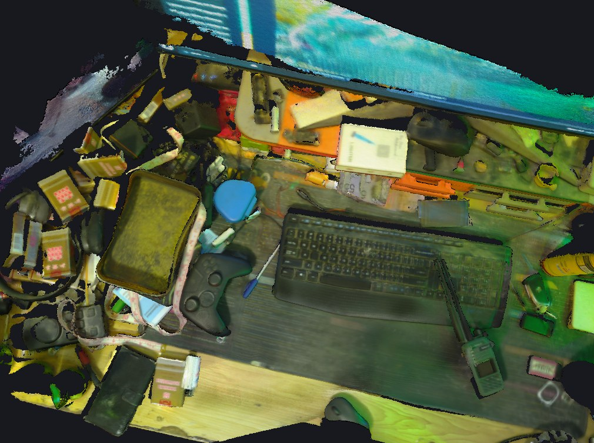
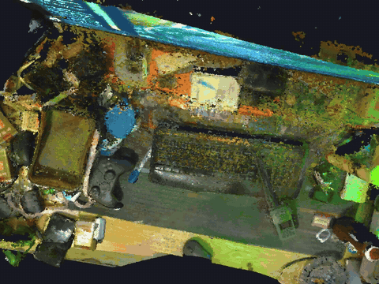
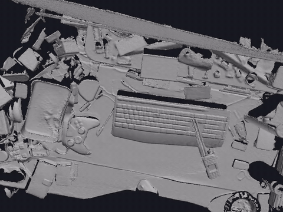
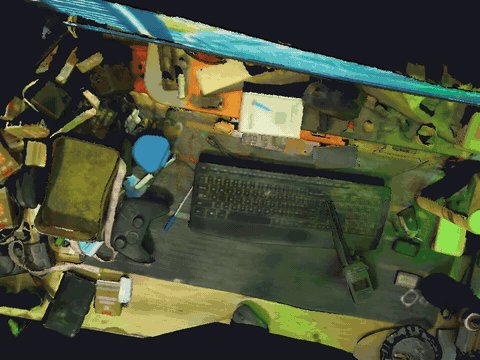

# Ubuntu Ferret Scanner

An independent, native Ubuntu app for the Creality Ferret 3D scanner, over USB
and WiFi.

**Status: early.** USB scanning, the live cloud and model building run on Ubuntu, tested
mainly on one Ferret Pro. WiFi and the motion sensor are not done. Calibration values are
currently built in from that one scanner, so another scanner would need its own.

## Preview

The first 10 seconds of a handheld desk scan, replayed from its recording through the app.
The cloud builds as tracking follows the scanner, with the distance gauge on the left. The
infrared tile is empty because recordings don't save infrared.



[Watch the sharper MP4](docs/images/app-replay.mp4)

The app during a scan, with the rough live cloud, colour and depth previews:



The models built from that 74-second scan, at 0.7 mm detail with about 9 million triangles:

| Bare model | Textured model |
|---|---|
|  |  |

Turning the same scan around shows the depth. Each clip links to a sharper MP4:

| Point cloud | Bare model | Textured model |
|---|---|---|
| [](docs/images/orbit-cloud.mp4) | [](docs/images/orbit-bare.mp4) | [](docs/images/orbit-textured.mp4) |

These come from one handheld scan on one desk, with no manual cleanup of the surfaces. The
green tint is RGB lighting in the room. Accuracy is still being measured. For privacy, the left
edge of the scan is cut from the rotating clips, and a corner of the replay video is blurred
for its last 1.5 seconds to hide on-screen text.

## Run it

```bash
scripts/install-dev.sh
```

Then start Ubuntu Ferret Scanner from the app menu. Connecting turns on the scanner's
projector, so keep it pointed away from eyes. RGB lighting and coloured screens tint the
textures, so plain white light gives truer colours.

Scans are saved as they are recorded to `~/FerretScans`, and models are built from them
afterwards. A CUDA GPU is strongly recommended.

This project is not affiliated with or endorsed by Creality. "Creality" and
"Ferret" are used only to say which hardware this works with.

## Goals

- Run natively on Ubuntu, with no Windows, Wine or VM.
- Connect over USB, WiFi, or both.
- Match the official app's scan quality, measured on the same captures.
- Handle scans far larger than the official app can.

## Why large scans should be possible

The scanner streams data to the PC, so the link sets a data rate rather than a
maximum scan size. What limits a scan is how the software handles that data.
This project treats size as a design requirement:

- Write raw frames to disk as they arrive, so a crash loses little or nothing.
- Keep only the working area of the scan in memory, with a fixed cap.
- Build the model from chunks that can be loaded and merged independently.
- Allow an interrupted scan to be resumed or reprocessed.

Memory is only half of the problem. Tracking error builds up over long scans,
so large scans also need loop closure and global alignment, or the model will
bend and fail to meet itself. "No size limit" has to be proven on real scans.

## Updates and problem reports

`ubuntu-ferret-scanner update` checks this repo's latest GitHub release, and
`ubuntu-ferret-scanner update --install` installs a verified newer wheel. Updates need
a public repo or a release token. While this repo is private, the check finds nothing.

Crashes and `ubuntu-ferret-scanner report "note"` send a report to the developer's own
server (ssjrocks.com). A report holds the app version, a random install ID, PC model, OS
and kernel, Python version, the stack trace and the app's log. It holds no scan data.

## Clean-room rules

All code here must be written independently. See
[docs/CLEAN_ROOM.md](docs/CLEAN_ROOM.md) before contributing.

## Licence

Not chosen yet. All rights reserved until a licence is added.
